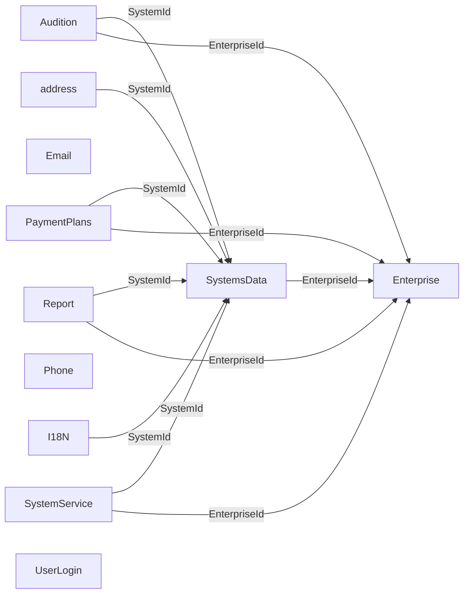

> Aviso de versionamento (extração via IA — Cursor): Este documento é um retrato da estrutura do banco SQL Server da WeCareU no momento da extração (2026-10-21). Descreve objetos, colunas ou campos, chaves, índices, volumes e relações. Não traz o conteúdo das linhas, não cruza com código e não descreve tela. Pode estar à frente ou atrás da base de conhecimento principal. Em caso de conflito com o repositório oficial ou com uma decisão da empresa, vale a fonte oficial.

# Relações entre os bancos SQL

Recorte de 2026-10-21. Cada item abaixo é um par do arquivo de candidatos. O nome da coluna sugere o outro lado. Nada nesta lista é constraint.

## Relações declaradas

Nenhuma no recorte. Não há chave estrangeira declarada nos 11 bancos SQL. O Mongo não declara FK para o SQL.

## Colunas de auditoria

As colunas `Created`, `ChangedBy`, `IsActive`, `DtChange` e `Change` não são ligação.

## Diagrama

Os onze bancos do recorte. Aresta só quando existe pelo menos um par forte entre dois bancos diferentes. O rótulo é o padrão do nome. Ligação dentro do mesmo banco (`PaymentPlanId`, `ReportId`, `GroupId`, `PermissionId`, `ScreenId`, `CompanyId`, `ScheduleId`) fica na lista, não neste desenho.

## Ligações inferidas

### address

- `address.address.SystemId` (`uniqueidentifier`) para `SystemsData.Systems.Id` (`uniqueidentifier`). Força forte. [[banco-sql-address]] · [[banco-sql-systemsdata]]. Inferida pelo nome da coluna, não é constraint.

### Audition

- `Audition.Audit.SystemId` (`uniqueidentifier`) para `SystemsData.Systems.Id` (`uniqueidentifier`). Força forte. [[banco-sql-audition]] · [[banco-sql-systemsdata]]. Inferida pelo nome da coluna, não é constraint.
- `Audition.Audit.EnterpriseId` (`uniqueidentifier`) para `Enterprise.Enterprise.Id` (`uniqueidentifier`). Força forte. [[banco-sql-audition]] · [[banco-sql-enterprise]]. Inferida pelo nome da coluna, não é constraint.
- `Audition.Audit.UserId` (`uniqueidentifier`) para `UserLogin.Usuario.Id` (`uniqueidentifier`). Força fraca. [[banco-sql-audition]] · [[banco-sql-userlogin]]. Inferida pelo nome da coluna, não é constraint.

### I18N

- `I18N.I18N.SystemId` (`uniqueidentifier`) para `SystemsData.Systems.Id` (`uniqueidentifier`). Força forte. [[banco-sql-i18n]] · [[banco-sql-systemsdata]]. Inferida pelo nome da coluna, não é constraint.
- `I18N.I18N.Screen` (`uniqueidentifier`) para `SystemsData.Screens.Id` (`uniqueidentifier`). Força fraca. [[banco-sql-i18n]] · [[banco-sql-systemsdata]]. Inferida pelo nome da coluna, não é constraint.
- `I18N.I18N.Enterprise` (`uniqueidentifier`) para `Enterprise.Enterprise.Id` (`uniqueidentifier`). Força fraca. [[banco-sql-i18n]] · [[banco-sql-enterprise]]. Inferida pelo nome da coluna, não é constraint.

### PaymentPlans

- `PaymentPlans.Cupom.SystemId` (`uniqueidentifier`) para `SystemsData.Systems.Id` (`uniqueidentifier`). Força forte. [[banco-sql-paymentplans]] · [[banco-sql-systemsdata]]. Inferida pelo nome da coluna, não é constraint.
- `PaymentPlans.Cupom.EnterpriseId` (`uniqueidentifier`) para `Enterprise.Enterprise.Id` (`uniqueidentifier`). Força forte. [[banco-sql-paymentplans]] · [[banco-sql-enterprise]]. Inferida pelo nome da coluna, não é constraint.
- `PaymentPlans.PaymentPlans.SystemId` (`uniqueidentifier`) para `SystemsData.Systems.Id` (`uniqueidentifier`). Força forte. [[banco-sql-paymentplans]] · [[banco-sql-systemsdata]]. Inferida pelo nome da coluna, não é constraint.
- `PaymentPlans.PaymentPlans.EnterpriseId` (`uniqueidentifier`) para `Enterprise.Enterprise.Id` (`uniqueidentifier`). Força forte. [[banco-sql-paymentplans]] · [[banco-sql-enterprise]]. Inferida pelo nome da coluna, não é constraint.
- `PaymentPlans.PlanDurationValue.PaymentPlanId` (`uniqueidentifier`) para `PaymentPlans.PaymentPlans.Id` (`uniqueidentifier`). Força forte. [[banco-sql-paymentplans]]. Inferida pelo nome da coluna, não é constraint.

### Report

- `Report.Report.SystemId` (`uniqueidentifier`) para `SystemsData.Systems.Id` (`uniqueidentifier`). Força forte. [[banco-sql-report]] · [[banco-sql-systemsdata]]. Inferida pelo nome da coluna, não é constraint.
- `Report.Report.EnterpriseId` (`uniqueidentifier`) para `Enterprise.Enterprise.Id` (`uniqueidentifier`). Força forte. [[banco-sql-report]] · [[banco-sql-enterprise]]. Inferida pelo nome da coluna, não é constraint.
- `Report.Report.UserId` (`uniqueidentifier`) para `UserLogin.Usuario.Id` (`uniqueidentifier`). Força fraca. [[banco-sql-report]] · [[banco-sql-userlogin]]. Inferida pelo nome da coluna, não é constraint.
- `Report.Report.ReportedUserId` (`uniqueidentifier`) para `UserLogin.Usuario.Id` (`uniqueidentifier`). Força fraca. [[banco-sql-report]] · [[banco-sql-userlogin]]. Inferida pelo nome da coluna, não é constraint.
- `Report.ReportFotos.SystemId` (`uniqueidentifier`) para `SystemsData.Systems.Id` (`uniqueidentifier`). Força forte. [[banco-sql-report]] · [[banco-sql-systemsdata]]. Inferida pelo nome da coluna, não é constraint.
- `Report.ReportFotos.EnterpriseId` (`uniqueidentifier`) para `Enterprise.Enterprise.Id` (`uniqueidentifier`). Força forte. [[banco-sql-report]] · [[banco-sql-enterprise]]. Inferida pelo nome da coluna, não é constraint.
- `Report.ReportFotos.ReportId` (`uniqueidentifier`) para `Report.Report.Id` (`uniqueidentifier`). Força forte. [[banco-sql-report]]. Inferida pelo nome da coluna, não é constraint.

### SystemsData

- `SystemsData.EnterpriseSystems.EnterpriseId` (`uniqueidentifier`) para `Enterprise.Enterprise.Id` (`uniqueidentifier`). Força forte. [[banco-sql-systemsdata]] · [[banco-sql-enterprise]]. Inferida pelo nome da coluna, não é constraint.
- `SystemsData.EnterpriseSystems.SystemId` (`uniqueidentifier`) para `SystemsData.Systems.Id` (`uniqueidentifier`). Força forte. [[banco-sql-systemsdata]]. Inferida pelo nome da coluna, não é constraint.
- `SystemsData.Groups.SystemId` (`uniqueidentifier`) para `SystemsData.Systems.Id` (`uniqueidentifier`). Força forte. [[banco-sql-systemsdata]]. Inferida pelo nome da coluna, não é constraint.
- `SystemsData.Groups.ScreenId` (`uniqueidentifier`) para `SystemsData.Screens.Id` (`uniqueidentifier`). Força forte. [[banco-sql-systemsdata]]. Inferida pelo nome da coluna, não é constraint.
- `SystemsData.Groups.EnterpriseId` (`uniqueidentifier`) para `Enterprise.Enterprise.Id` (`uniqueidentifier`). Força forte. [[banco-sql-systemsdata]] · [[banco-sql-enterprise]]. Inferida pelo nome da coluna, não é constraint.
- `SystemsData.GroupsPermissions.GroupId` (`uniqueidentifier`) para `SystemsData.Groups.Id` (`uniqueidentifier`). Força forte. [[banco-sql-systemsdata]]. Inferida pelo nome da coluna, não é constraint.
- `SystemsData.GroupsPermissions.PermissionId` (`uniqueidentifier`) para `SystemsData.Permissions.Id` (`uniqueidentifier`). Força forte. [[banco-sql-systemsdata]]. Inferida pelo nome da coluna, não é constraint.
- `SystemsData.Permissions.SystemId` (`uniqueidentifier`) para `SystemsData.Systems.Id` (`uniqueidentifier`). Força forte. [[banco-sql-systemsdata]]. Inferida pelo nome da coluna, não é constraint.
- `SystemsData.Permissions.ScreenId` (`uniqueidentifier`) para `SystemsData.Screens.Id` (`uniqueidentifier`). Força forte. [[banco-sql-systemsdata]]. Inferida pelo nome da coluna, não é constraint.
- `SystemsData.Screens.SystemId` (`uniqueidentifier`) para `SystemsData.Systems.Id` (`uniqueidentifier`). Força forte. [[banco-sql-systemsdata]]. Inferida pelo nome da coluna, não é constraint.

### SystemService

- `SystemService.CompanyUsers.CompanyId` (`uniqueidentifier`) para `SystemService.Company.Id` (`uniqueidentifier`). Força forte. [[banco-sql-systemservice]]. Inferida pelo nome da coluna, não é constraint.
- `SystemService.CompanyUsers.UserId` (`uniqueidentifier`) para `UserLogin.Usuario.Id` (`uniqueidentifier`). Força fraca. [[banco-sql-systemservice]] · [[banco-sql-userlogin]]. Inferida pelo nome da coluna, não é constraint.
- `SystemService.Schedule.RequestedUserId` (`uniqueidentifier`) para `UserLogin.Usuario.Id` (`uniqueidentifier`). Força fraca. [[banco-sql-systemservice]] · [[banco-sql-userlogin]]. Inferida pelo nome da coluna, não é constraint.
- `SystemService.Schedule.ProviderUserId` (`uniqueidentifier`) para `UserLogin.Usuario.Id` (`uniqueidentifier`). Força fraca. [[banco-sql-systemservice]] · [[banco-sql-userlogin]]. Inferida pelo nome da coluna, não é constraint.
- `SystemService.Schedule.CompanyId` (`uniqueidentifier`) para `SystemService.Company.Id` (`uniqueidentifier`). Força forte. [[banco-sql-systemservice]]. Inferida pelo nome da coluna, não é constraint.
- `SystemService.Schedule.ServiceProvideAddressId` (`uniqueidentifier`) para `address.address.Id` (`uniqueidentifier`). Força fraca. [[banco-sql-systemservice]] · [[banco-sql-address]]. Inferida pelo nome da coluna, não é constraint.
- `SystemService.ScheduleServicesProvided.ScheduleId` (`uniqueidentifier`) para `SystemService.Schedule.Id` (`uniqueidentifier`). Força forte. [[banco-sql-systemservice]]. Inferida pelo nome da coluna, não é constraint.
- `SystemService.SystemService.SystemId` (`uniqueidentifier`) para `SystemsData.Systems.Id` (`uniqueidentifier`). Força forte. [[banco-sql-systemservice]] · [[banco-sql-systemsdata]]. Inferida pelo nome da coluna, não é constraint.
- `SystemService.SystemService.EnterpriseId` (`uniqueidentifier`) para `Enterprise.Enterprise.Id` (`uniqueidentifier`). Força forte. [[banco-sql-systemservice]] · [[banco-sql-enterprise]]. Inferida pelo nome da coluna, não é constraint.
- `SystemService.UserService.SystemId` (`uniqueidentifier`) para `SystemsData.Systems.Id` (`uniqueidentifier`). Força forte. [[banco-sql-systemservice]] · [[banco-sql-systemsdata]]. Inferida pelo nome da coluna, não é constraint.
- `SystemService.UserService.EnterpriseId` (`uniqueidentifier`) para `Enterprise.Enterprise.Id` (`uniqueidentifier`). Força forte. [[banco-sql-systemservice]] · [[banco-sql-enterprise]]. Inferida pelo nome da coluna, não é constraint.
- `SystemService.UserService.UserId` (`uniqueidentifier`) para `UserLogin.Usuario.Id` (`uniqueidentifier`). Força fraca. [[banco-sql-systemservice]] · [[banco-sql-userlogin]]. Inferida pelo nome da coluna, não é constraint.

### UserLogin

- `UserLogin.BlockUsers.UserId` (`uniqueidentifier`) para `UserLogin.Usuario.Id` (`uniqueidentifier`). Força fraca. [[banco-sql-userlogin]]. Inferida pelo nome da coluna, não é constraint.
- `UserLogin.BlockUsers.BlockedUserId` (`uniqueidentifier`) para `UserLogin.Usuario.Id` (`uniqueidentifier`). Força fraca. [[banco-sql-userlogin]]. Inferida pelo nome da coluna, não é constraint.
- `UserLogin.GrupoUsuario.FkGroup` (`uniqueidentifier`) para `SystemsData.Groups.Id` (`uniqueidentifier`). Força fraca. [[banco-sql-userlogin]] · [[banco-sql-systemsdata]]. Inferida pelo nome da coluna, não é constraint.
- `UserLogin.GrupoUsuario.FkUser` (`uniqueidentifier`) para `UserLogin.Usuario.Id` (`uniqueidentifier`). Força fraca. [[banco-sql-userlogin]]. Inferida pelo nome da coluna, não é constraint.
- `UserLogin.GrupoUsuario.System` (`uniqueidentifier`) para `SystemsData.Systems.Id` (`uniqueidentifier`). Força fraca. [[banco-sql-userlogin]] · [[banco-sql-systemsdata]]. Inferida pelo nome da coluna, não é constraint.
- `UserLogin.Session.FkUser` (`uniqueidentifier`) para `UserLogin.Usuario.Id` (`uniqueidentifier`). Força fraca. [[banco-sql-userlogin]]. Inferida pelo nome da coluna, não é constraint.
- `UserLogin.Session.FkSystem` (`uniqueidentifier`) para `SystemsData.Systems.Id` (`uniqueidentifier`). Força fraca. [[banco-sql-userlogin]] · [[banco-sql-systemsdata]]. Inferida pelo nome da coluna, não é constraint.
- `UserLogin.Usuario.FkEnterprise` (`uniqueidentifier`) para `Enterprise.Enterprise.Id` (`uniqueidentifier`). Força fraca. [[banco-sql-userlogin]] · [[banco-sql-enterprise]]. Inferida pelo nome da coluna, não é constraint.
- `UserLogin.forgetpassword.iduser` (`uniqueidentifier`) para `UserLogin.Usuario.Id` (`uniqueidentifier`). Força fraca. [[banco-sql-userlogin]]. Inferida pelo nome da coluna, não é constraint.

## Chaves primárias com o mesmo nome

- `UserLogin.GrupoUsuario.idsession` e `UserLogin.Session.idsession`. As duas chaves primárias usam o mesmo nome de coluna. Não é uma coluna solta apontando para a outra. Força fraca. [[banco-sql-userlogin]].

## Sem destino único no recorte

- `address.address.OwnerId` (`uniqueidentifier`). [[banco-sql-address]]. Sem destino único no recorte.
- `Audition.Audit.AprovedId` (`uniqueidentifier`). [[banco-sql-audition]]. Sem destino único no recorte.
- `Email.EmailOptions.Owner` (`uniqueidentifier`). [[banco-sql-email]]. Sem destino único no recorte.
- `Email.Emails.OwnerIndentifier` (`uniqueidentifier`). [[banco-sql-email]]. Sem destino único no recorte.
- `Enterprise.Enterprise.ServicePlanId` (`uniqueidentifier`). [[banco-sql-enterprise]]. Sem destino único no recorte.
- `Enterprise.Enterprise.Logo` (`uniqueidentifier`). [[banco-sql-enterprise]]. Sem destino único no recorte.
- `Phone.Telefones.OwnerId` (`uniqueidentifier`). [[banco-sql-phone]]. Sem destino único no recorte.
- `Report.Report.ReportedItemId` (`uniqueidentifier`). [[banco-sql-report]]. Sem destino único no recorte.
- `SystemService.Company.Logo` (`uniqueidentifier`). [[banco-sql-systemservice]]. Sem destino único no recorte.
- `SystemService.ScheduleServicesProvided.ServiceId` (`uniqueidentifier`). [[banco-sql-systemservice]]. Sem destino único no recorte.
- `SystemService.UserService.ServiceId` (`uniqueidentifier`). [[banco-sql-systemservice]]. Sem destino único no recorte.
- `UserLogin.Usuario.FkUserType` (`uniqueidentifier`). [[banco-sql-userlogin]]. Sem destino único no recorte.
- `UserLogin.Usuario.FkFoto` (`uniqueidentifier`). [[banco-sql-userlogin]]. Sem destino único no recorte.
- `UserLogin.Usuario.FkSignature` (`uniqueidentifier`). [[banco-sql-userlogin]]. Sem destino único no recorte.

## Ligações

[[banco-indice]]

[[banco-mongo-relacoes]]
