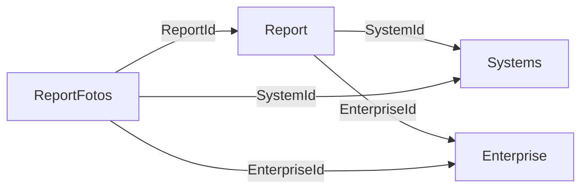

> Aviso de versionamento (extração via IA — Cursor): Este documento é um retrato da estrutura do banco SQL Server da WeCareU no momento da extração (2026-10-21). Descreve objetos, colunas ou campos, chaves, índices, volumes e relações. Não traz o conteúdo das linhas, não cruza com código e não descreve tela. Pode estar à frente ou atrás da base de conhecimento principal. Em caso de conflito com o repositório oficial ou com uma decisão da empresa, vale a fonte oficial.

# Banco `Report`

Extração em 2026-10-21, host `server.wecareu.app`, collation `Latin1_General_CI_AS`, edição Developer Edition (64-bit), versão 16.0.4305.5 (RTM).

## Leitura da estrutura

Isto é leitura da estrutura, não decisão de produto. O nome do banco `Report` e o das tabelas `Report` e `ReportFotos` sugerem um reporte e fotos ligadas a esse reporte. `ReportFotos` tem a coluna `ReportId`. As duas tabelas têm `SystemId` e `EnterpriseId`. `Report` também tem `UserId`, `ReportedUserId` e `ReportedItemId`. `ReportFotos` também tem `PhotoId`.

## Objetos que este banco não tem

Views: nenhuma. Procedures: nenhuma. Functions: nenhuma. Synonyms: nenhum. Triggers: nenhum. Checks: nenhum. Chaves estrangeiras: nenhuma. Índices além da chave primária: nenhum.

## Tabela `dbo.Report`

- Linhas: 0. A contagem vem de `sys.partitions` (heap ou índice clustered), sem leitura das linhas.
- Chave primária: `PK__Report__3214EC07BBA96A10` na coluna `Id`.
- Unique: Nenhuma.
- Índices além da PK: Nenhum.
- Chaves estrangeiras: Nenhuma.
- Checks e triggers: Nenhum.

| Coluna | Tipo | Nulo | Identity | Default | Collation |
| --- | --- | --- | --- | --- | --- |
| `Id` | `uniqueidentifier` | não | não | `DF__Report__Id__36B12243` — expressão não visível para o login de leitura (sem VIEW DEFINITION) | — |
| `SystemId` | `uniqueidentifier` | não | não | nenhum | — |
| `EnterpriseId` | `uniqueidentifier` | não | não | nenhum | — |
| `UserId` | `uniqueidentifier` | não | não | nenhum | — |
| `ReportedUserId` | `uniqueidentifier` | não | não | nenhum | — |
| `ReportedItemId` | `uniqueidentifier` | sim | não | nenhum | — |
| `ReportedTable` | `varchar(100)` | sim | não | nenhum | `Latin1_General_CI_AS` |
| `ReportDescription` | `text` | não | não | nenhum | `Latin1_General_CI_AS` |
| `IsActive` | `bit` | não | não | `DF__Report__IsActive__37A5467C` — expressão não visível para o login de leitura (sem VIEW DEFINITION) | — |
| `Created` | `date` | não | não | `DF__Report__Created__38996AB5` — expressão não visível para o login de leitura (sem VIEW DEFINITION) | — |
| `DtChange` | `date` | não | não | `DF__Report__DtChange__398D8EEE` — expressão não visível para o login de leitura (sem VIEW DEFINITION) | — |
| `ChangedBy` | `varchar(50)` | não | não | nenhum | `Latin1_General_CI_AS` |

## Tabela `dbo.ReportFotos`

- Linhas: 0. A contagem vem de `sys.partitions` (heap ou índice clustered), sem leitura das linhas.
- Chave primária: `PK__ReportFo__3214EC07C3A7F722` na coluna `Id`.
- Unique: Nenhuma.
- Índices além da PK: Nenhum.
- Chaves estrangeiras: Nenhuma.
- Checks e triggers: Nenhum.

| Coluna | Tipo | Nulo | Identity | Default | Collation |
| --- | --- | --- | --- | --- | --- |
| `Id` | `uniqueidentifier` | não | não | `DF__ReportFotos__Id__3C69FB99` — expressão não visível para o login de leitura (sem VIEW DEFINITION) | — |
| `SystemId` | `uniqueidentifier` | não | não | nenhum | — |
| `EnterpriseId` | `uniqueidentifier` | não | não | nenhum | — |
| `ReportId` | `uniqueidentifier` | não | não | nenhum | — |
| `PhotoId` | `uniqueidentifier` | não | não | nenhum | — |
| `IsActive` | `bit` | não | não | `DF__ReportFot__IsAct__3D5E1FD2` — expressão não visível para o login de leitura (sem VIEW DEFINITION) | — |
| `Created` | `date` | não | não | `DF__ReportFot__Creat__3E52440B` — expressão não visível para o login de leitura (sem VIEW DEFINITION) | — |
| `DtChange` | `date` | não | não | `DF__ReportFot__DtCha__3F466844` — expressão não visível para o login de leitura (sem VIEW DEFINITION) | — |
| `ChangedBy` | `varchar(50)` | não | não | nenhum | `Latin1_General_CI_AS` |

## Diagrama

## Relações declaradas

Nenhuma neste banco.

## Nomes que parecem ligação

- `dbo.Report.SystemId` e `dbo.Systems.Id` (banco `SystemsData`). Inferida pelo nome da coluna, não é constraint.
- `dbo.Report.EnterpriseId` e `dbo.Enterprise.Id` (banco `Enterprise`). Inferida pelo nome da coluna, não é constraint.
- `dbo.ReportFotos.SystemId` e `dbo.Systems.Id` (banco `SystemsData`). Inferida pelo nome da coluna, não é constraint.
- `dbo.ReportFotos.EnterpriseId` e `dbo.Enterprise.Id` (banco `Enterprise`). Inferida pelo nome da coluna, não é constraint.
- `dbo.ReportFotos.ReportId` e `dbo.Report.Id` (banco `Report`). Inferida pelo nome da coluna, não é constraint.

## Ligações

- [[banco-indice]]
- [[banco-sql-relacoes]]
- [[banco-sql-audition]]
- [[banco-sql-paymentplans]]
