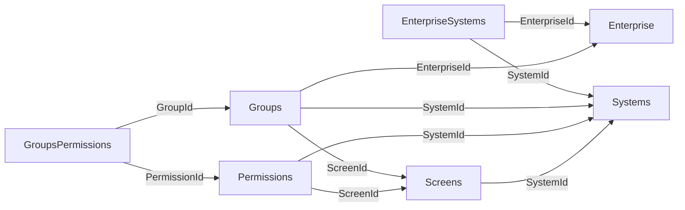

> Aviso de versionamento (extração via IA — Cursor): Este documento é um retrato da estrutura do banco SQL Server da WeCareU no momento da extração (2026-10-21). Descreve objetos, colunas ou campos, chaves, índices, volumes e relações. Não traz o conteúdo das linhas, não cruza com código e não descreve tela. Pode estar à frente ou atrás da base de conhecimento principal. Em caso de conflito com o repositório oficial ou com uma decisão da empresa, vale a fonte oficial.

# Banco `SystemsData`

Extração em 2026-10-21, host `server.wecareu.app`, collation `Latin1_General_CI_AS`, edição Developer Edition (64-bit), versão do produto 16.0.4305.5 (RTM).

## Leitura da estrutura

Isto é leitura da estrutura, não decisão de produto. O nome `SystemsData` e as tabelas `EnterpriseSystems`, `Groups`, `GroupsPermissions`, `Permissions`, `Screens` e `Systems` sugerem cadastro de sistemas, telas e permissões em grupo, com colunas cujo nome aponta para empresa e para sistema.

## Objetos que este banco não tem

Views: Nenhuma. Procedures: Nenhuma. Functions: Nenhuma. Synonyms: Nenhum.

Em todas as tabelas, triggers: Nenhum. Checks: Nenhum. Chaves estrangeiras: Nenhuma. Índices além da chave primária: Nenhum. Não há chave estrangeira declarada.

## Tabela `dbo.EnterpriseSystems`

Linhas: 2. A contagem vem de `sys.partitions` (heap ou índice clustered), sem leitura das linhas.

Chave primária: `PK__Enterpri__3214EC0740ABAF2A` nas colunas `Id`.

Unique: Nenhuma.

Índices além da PK: Nenhum.

Chaves estrangeiras: Nenhuma.

Checks e triggers: Nenhum.

| Coluna | Tipo | Nulo | Identity | Default | Collation |
| --- | --- | --- | --- | --- | --- |
| `Id` | `uniqueidentifier` | não | não | `DF__EnterpriseSy__Id__36B12243` — expressão não visível para o login de leitura (sem VIEW DEFINITION) | — |
| `EnterpriseId` | `uniqueidentifier` | não | não | nenhum | — |
| `SystemId` | `uniqueidentifier` | não | não | nenhum | — |
| `IsActive` | `bit` | não | não | `DF__Enterpris__IsAct__37A5467C` — expressão não visível para o login de leitura (sem VIEW DEFINITION) | — |
| `Created` | `date` | não | não | `DF__Enterpris__Creat__38996AB5` — expressão não visível para o login de leitura (sem VIEW DEFINITION) | — |
| `DtChange` | `date` | não | não | `DF__Enterpris__DtCha__398D8EEE` — expressão não visível para o login de leitura (sem VIEW DEFINITION) | — |
| `ChangedBy` | `varchar(50)` | não | não | nenhum | `Latin1_General_CI_AS` |

## Tabela `dbo.Groups`

Linhas: 0. A contagem vem de `sys.partitions` (heap ou índice clustered), sem leitura das linhas.

Chave primária: `PK__Groups__3214EC073EB349D9` nas colunas `Id`.

Unique: Nenhuma.

Índices além da PK: Nenhum.

Chaves estrangeiras: Nenhuma.

Checks e triggers: Nenhum.

| Coluna | Tipo | Nulo | Identity | Default | Collation |
| --- | --- | --- | --- | --- | --- |
| `Id` | `uniqueidentifier` | não | não | `DF__Groups__Id__4222D4EF` — expressão não visível para o login de leitura (sem VIEW DEFINITION) | — |
| `Name` | `varchar(max)` | não | não | nenhum | `Latin1_General_CI_AS` |
| `SystemId` | `uniqueidentifier` | não | não | nenhum | — |
| `ScreenId` | `uniqueidentifier` | não | não | nenhum | — |
| `EnterpriseId` | `uniqueidentifier` | não | não | nenhum | — |
| `IsActive` | `bit` | não | não | `DF__Groups__IsActive__4316F928` — expressão não visível para o login de leitura (sem VIEW DEFINITION) | — |
| `Created` | `date` | não | não | `DF__Groups__Created__440B1D61` — expressão não visível para o login de leitura (sem VIEW DEFINITION) | — |
| `DtChange` | `date` | não | não | `DF__Groups__DtChange__44FF419A` — expressão não visível para o login de leitura (sem VIEW DEFINITION) | — |
| `ChangedBy` | `varchar(50)` | não | não | nenhum | `Latin1_General_CI_AS` |

## Tabela `dbo.GroupsPermissions`

Linhas: 0. A contagem vem de `sys.partitions` (heap ou índice clustered), sem leitura das linhas.

Chave primária: `PK__GroupsPe__3214EC0742D17F9C` nas colunas `Id`.

Unique: Nenhuma.

Índices além da PK: Nenhum.

Chaves estrangeiras: Nenhuma.

Checks e triggers: Nenhum.

| Coluna | Tipo | Nulo | Identity | Default | Collation |
| --- | --- | --- | --- | --- | --- |
| `Id` | `uniqueidentifier` | não | não | `DF__GroupsPermis__Id__3C69FB99` — expressão não visível para o login de leitura (sem VIEW DEFINITION) | — |
| `GroupId` | `uniqueidentifier` | não | não | nenhum | — |
| `PermissionId` | `uniqueidentifier` | não | não | nenhum | — |
| `EnumTypePermission` | `int` | não | não | nenhum | — |
| `IsActive` | `bit` | não | não | `DF__GroupsPer__IsAct__3D5E1FD2` — expressão não visível para o login de leitura (sem VIEW DEFINITION) | — |
| `Created` | `date` | não | não | `DF__GroupsPer__Creat__3E52440B` — expressão não visível para o login de leitura (sem VIEW DEFINITION) | — |
| `DtChange` | `date` | não | não | `DF__GroupsPer__DtCha__3F466844` — expressão não visível para o login de leitura (sem VIEW DEFINITION) | — |
| `ChangedBy` | `varchar(50)` | não | não | nenhum | `Latin1_General_CI_AS` |

## Tabela `dbo.Permissions`

Linhas: 0. A contagem vem de `sys.partitions` (heap ou índice clustered), sem leitura das linhas.

Chave primária: `PK__Permissi__3214EC07A679FB1B` nas colunas `Id`.

Unique: Nenhuma.

Índices além da PK: Nenhum.

Chaves estrangeiras: Nenhuma.

Checks e triggers: Nenhum.

| Coluna | Tipo | Nulo | Identity | Default | Collation |
| --- | --- | --- | --- | --- | --- |
| `Id` | `uniqueidentifier` | não | não | `DF__Permissions__Id__47DBAE45` — expressão não visível para o login de leitura (sem VIEW DEFINITION) | — |
| `Name` | `varchar(max)` | não | não | nenhum | `Latin1_General_CI_AS` |
| `DisplayName` | `varchar(max)` | não | não | nenhum | `Latin1_General_CI_AS` |
| `SystemId` | `uniqueidentifier` | não | não | nenhum | — |
| `ScreenId` | `uniqueidentifier` | não | não | nenhum | — |
| `IsActive` | `bit` | não | não | `DF__Permissio__IsAct__48CFD27E` — expressão não visível para o login de leitura (sem VIEW DEFINITION) | — |
| `Created` | `date` | não | não | `DF__Permissio__Creat__49C3F6B7` — expressão não visível para o login de leitura (sem VIEW DEFINITION) | — |
| `DtChange` | `date` | não | não | `DF__Permissio__DtCha__4AB81AF0` — expressão não visível para o login de leitura (sem VIEW DEFINITION) | — |
| `ChangedBy` | `varchar(50)` | não | não | nenhum | `Latin1_General_CI_AS` |

## Tabela `dbo.Screens`

Linhas: 0. A contagem vem de `sys.partitions` (heap ou índice clustered), sem leitura das linhas.

Chave primária: `PK__Screens__3214EC0764BC039E` nas colunas `Id`.

Unique: Nenhuma.

Índices além da PK: Nenhum.

Chaves estrangeiras: Nenhuma.

Checks e triggers: Nenhum.

| Coluna | Tipo | Nulo | Identity | Default | Collation |
| --- | --- | --- | --- | --- | --- |
| `Id` | `uniqueidentifier` | não | não | `DF__Screens__Id__4D94879B` — expressão não visível para o login de leitura (sem VIEW DEFINITION) | — |
| `Name` | `varchar(max)` | não | não | nenhum | `Latin1_General_CI_AS` |
| `SystemId` | `uniqueidentifier` | não | não | nenhum | — |
| `IsActive` | `bit` | não | não | `DF__Screens__IsActiv__4E88ABD4` — expressão não visível para o login de leitura (sem VIEW DEFINITION) | — |
| `Created` | `date` | não | não | `DF__Screens__Created__4F7CD00D` — expressão não visível para o login de leitura (sem VIEW DEFINITION) | — |
| `DtChange` | `date` | não | não | `DF__Screens__DtChang__5070F446` — expressão não visível para o login de leitura (sem VIEW DEFINITION) | — |
| `ChangedBy` | `varchar(50)` | não | não | nenhum | `Latin1_General_CI_AS` |

## Tabela `dbo.Systems`

Linhas: 1. A contagem vem de `sys.partitions` (heap ou índice clustered), sem leitura das linhas.

Chave primária: `PK__Systems__3214EC075E59D679` nas colunas `Id`.

Unique: Nenhuma.

Índices além da PK: Nenhum.

Chaves estrangeiras: Nenhuma.

Checks e triggers: Nenhum.

| Coluna | Tipo | Nulo | Identity | Default | Collation |
| --- | --- | --- | --- | --- | --- |
| `Id` | `uniqueidentifier` | não | não | `DF__Systems__Id__534D60F1` — expressão não visível para o login de leitura (sem VIEW DEFINITION) | — |
| `PhotoId` | `uniqueidentifier` | não | não | nenhum | — |
| `Name` | `varchar(max)` | não | não | nenhum | `Latin1_General_CI_AS` |
| `Url` | `varchar(max)` | não | não | nenhum | `Latin1_General_CI_AS` |
| `IsActive` | `bit` | não | não | `DF__Systems__IsActiv__5441852A` — expressão não visível para o login de leitura (sem VIEW DEFINITION) | — |
| `Created` | `date` | não | não | `DF__Systems__Created__5535A963` — expressão não visível para o login de leitura (sem VIEW DEFINITION) | — |
| `DtChange` | `date` | não | não | `DF__Systems__DtChang__5629CD9C` — expressão não visível para o login de leitura (sem VIEW DEFINITION) | — |
| `ChangedBy` | `varchar(50)` | não | não | nenhum | `Latin1_General_CI_AS` |

## Relações declaradas

Nenhuma neste banco.

## Nomes que parecem ligação

- `SystemsData.dbo.EnterpriseSystems.EnterpriseId` para `Enterprise.dbo.Enterprise.Id`. Inferida pelo nome da coluna, não é constraint.
- `SystemsData.dbo.EnterpriseSystems.SystemId` para `SystemsData.dbo.Systems.Id`. Inferida pelo nome da coluna, não é constraint.
- `SystemsData.dbo.Groups.SystemId` para `SystemsData.dbo.Systems.Id`. Inferida pelo nome da coluna, não é constraint.
- `SystemsData.dbo.Groups.ScreenId` para `SystemsData.dbo.Screens.Id`. Inferida pelo nome da coluna, não é constraint.
- `SystemsData.dbo.Groups.EnterpriseId` para `Enterprise.dbo.Enterprise.Id`. Inferida pelo nome da coluna, não é constraint.
- `SystemsData.dbo.GroupsPermissions.GroupId` para `SystemsData.dbo.Groups.Id`. Inferida pelo nome da coluna, não é constraint.
- `SystemsData.dbo.GroupsPermissions.PermissionId` para `SystemsData.dbo.Permissions.Id`. Inferida pelo nome da coluna, não é constraint.
- `SystemsData.dbo.Permissions.SystemId` para `SystemsData.dbo.Systems.Id`. Inferida pelo nome da coluna, não é constraint.
- `SystemsData.dbo.Permissions.ScreenId` para `SystemsData.dbo.Screens.Id`. Inferida pelo nome da coluna, não é constraint.
- `SystemsData.dbo.Screens.SystemId` para `SystemsData.dbo.Systems.Id`. Inferida pelo nome da coluna, não é constraint.

## Ligações

[[banco-indice]] · [[banco-sql-relacoes]] · [[banco-sql-systemservice]]

## Diagrama

