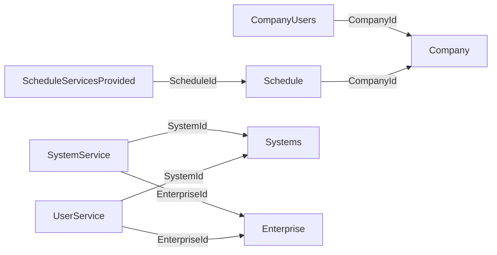

> Aviso de versionamento (extração via IA — Cursor): Este documento é um retrato da estrutura do banco SQL Server da WeCareU no momento da extração (2026-10-21). Descreve objetos, colunas ou campos, chaves, índices, volumes e relações. Não traz o conteúdo das linhas, não cruza com código e não descreve tela. Pode estar à frente ou atrás da base de conhecimento principal. Em caso de conflito com o repositório oficial ou com uma decisão da empresa, vale a fonte oficial.

# Banco `SystemService`

Extração em 2026-10-21, host `server.wecareu.app`, collation `Latin1_General_CI_AS`, edição Developer Edition (64-bit), versão do produto 16.0.4305.5 (RTM).

## Leitura da estrutura

Isto é leitura da estrutura, não decisão de produto. O nome `SystemService` e as tabelas `Company`, `CompanyUsers`, `Schedule`, `ScheduleServicesProvided`, `SystemService` e `UserService` sugerem empresas, usuários da empresa, agendas e serviços com colunas cujo nome aponta para sistema e para empresa.

## Objetos que este banco não tem

Views: Nenhuma. Procedures: Nenhuma. Functions: Nenhuma. Synonyms: Nenhum.

Em todas as tabelas, triggers: Nenhum. Checks: Nenhum. Chaves estrangeiras: Nenhuma. Índices além da chave primária: Nenhum. Não há chave estrangeira declarada.

## Tabela `dbo.Company`

Linhas: 0. A contagem vem de `sys.partitions` (heap ou índice clustered), sem leitura das linhas.

Chave primária: `PK__Company__3214EC07E57C33BF` nas colunas `Id`.

Unique: Nenhuma.

Índices além da PK: Nenhum.

Chaves estrangeiras: Nenhuma.

Checks e triggers: Nenhum.

| Coluna | Tipo | Nulo | Identity | Default | Collation |
| --- | --- | --- | --- | --- | --- |
| `Id` | `uniqueidentifier` | não | não | `DF__Company__Id__49C3F6B7` — expressão não visível para o login de leitura (sem VIEW DEFINITION) | — |
| `Name` | `varchar(max)` | não | não | nenhum | `Latin1_General_CI_AS` |
| `FantasyName` | `varchar(max)` | sim | não | nenhum | `Latin1_General_CI_AS` |
| `Cnpj` | `varchar(14)` | sim | não | nenhum | `Latin1_General_CI_AS` |
| `Representative` | `varchar(max)` | sim | não | nenhum | `Latin1_General_CI_AS` |
| `Logo` | `uniqueidentifier` | sim | não | nenhum | — |
| `IsActive` | `bit` | não | não | `DF__Company__IsActiv__4AB81AF0` — expressão não visível para o login de leitura (sem VIEW DEFINITION) | — |
| `Created` | `date` | não | não | `DF__Company__Created__4BAC3F29` — expressão não visível para o login de leitura (sem VIEW DEFINITION) | — |
| `DtChange` | `date` | não | não | `DF__Company__DtChang__4CA06362` — expressão não visível para o login de leitura (sem VIEW DEFINITION) | — |
| `ChangedBy` | `varchar(50)` | não | não | nenhum | `Latin1_General_CI_AS` |

## Tabela `dbo.CompanyUsers`

Linhas: 0. A contagem vem de `sys.partitions` (heap ou índice clustered), sem leitura das linhas.

Chave primária: `PK__CompanyU__97221D338951328F` nas colunas `CompanyUserId`.

Unique: Nenhuma.

Índices além da PK: Nenhum.

Chaves estrangeiras: Nenhuma.

Checks e triggers: Nenhum.

| Coluna | Tipo | Nulo | Identity | Default | Collation |
| --- | --- | --- | --- | --- | --- |
| `CompanyUserId` | `uniqueidentifier` | não | não | `DF__CompanyUs__Compa__4F7CD00D` — expressão não visível para o login de leitura (sem VIEW DEFINITION) | — |
| `CompanyId` | `uniqueidentifier` | não | não | nenhum | — |
| `UserId` | `uniqueidentifier` | não | não | nenhum | — |
| `IsActive` | `bit` | não | não | `DF__CompanyUs__IsAct__5070F446` — expressão não visível para o login de leitura (sem VIEW DEFINITION) | — |
| `Created` | `date` | não | não | `DF__CompanyUs__Creat__5165187F` — expressão não visível para o login de leitura (sem VIEW DEFINITION) | — |
| `DtChange` | `date` | não | não | `DF__CompanyUs__DtCha__52593CB8` — expressão não visível para o login de leitura (sem VIEW DEFINITION) | — |
| `ChangedBy` | `varchar(50)` | não | não | nenhum | `Latin1_General_CI_AS` |

## Tabela `dbo.Schedule`

Linhas: 0. A contagem vem de `sys.partitions` (heap ou índice clustered), sem leitura das linhas.

Chave primária: `PK__Schedule__3214EC0750FE12C8` nas colunas `Id`.

Unique: Nenhuma.

Índices além da PK: Nenhum.

Chaves estrangeiras: Nenhuma.

Checks e triggers: Nenhum.

| Coluna | Tipo | Nulo | Identity | Default | Collation |
| --- | --- | --- | --- | --- | --- |
| `Id` | `uniqueidentifier` | não | não | `DF__Schedule__Id__5535A963` — expressão não visível para o login de leitura (sem VIEW DEFINITION) | — |
| `RequestedUserId` | `uniqueidentifier` | não | não | nenhum | — |
| `ProviderUserId` | `uniqueidentifier` | não | não | nenhum | — |
| `CompanyId` | `uniqueidentifier` | não | não | nenhum | — |
| `ServiceProvideAddressId` | `uniqueidentifier` | não | não | nenhum | — |
| `ScheduleDate` | `date` | não | não | nenhum | — |
| `EndPrevision` | `date` | não | não | nenhum | — |
| `Duration` | `date` | não | não | nenhum | — |
| `IsDelivery` | `bit` | não | não | `DF__Schedule__IsDeli__5629CD9C` — expressão não visível para o login de leitura (sem VIEW DEFINITION) | — |
| `StatusSchedule` | `int` | não | não | `DF__Schedule__Status__571DF1D5` — expressão não visível para o login de leitura (sem VIEW DEFINITION) | — |
| `IsActive` | `bit` | não | não | `DF__Schedule__IsActi__5812160E` — expressão não visível para o login de leitura (sem VIEW DEFINITION) | — |
| `Created` | `date` | não | não | `DF__Schedule__Create__59063A47` — expressão não visível para o login de leitura (sem VIEW DEFINITION) | — |
| `DtChange` | `date` | não | não | `DF__Schedule__DtChan__59FA5E80` — expressão não visível para o login de leitura (sem VIEW DEFINITION) | — |
| `ChangedBy` | `varchar(50)` | não | não | nenhum | `Latin1_General_CI_AS` |

## Tabela `dbo.ScheduleServicesProvided`

Linhas: 0. A contagem vem de `sys.partitions` (heap ou índice clustered), sem leitura das linhas.

Chave primária: `PK__Schedule__3214EC07779BF831` nas colunas `Id`.

Unique: Nenhuma.

Índices além da PK: Nenhum.

Chaves estrangeiras: Nenhuma.

Checks e triggers: Nenhum.

| Coluna | Tipo | Nulo | Identity | Default | Collation |
| --- | --- | --- | --- | --- | --- |
| `Id` | `uniqueidentifier` | não | não | `DF__ScheduleServ__Id__5CD6CB2B` — expressão não visível para o login de leitura (sem VIEW DEFINITION) | — |
| `ScheduleId` | `uniqueidentifier` | não | não | nenhum | — |
| `ServiceId` | `uniqueidentifier` | não | não | nenhum | — |
| `ScheduleDate` | `date` | não | não | nenhum | — |
| `EndPrevision` | `date` | não | não | nenhum | — |
| `Observation` | `varchar(max)` | sim | não | nenhum | `Latin1_General_CI_AS` |
| `IsActive` | `bit` | não | não | `DF__ScheduleS__IsAct__5DCAEF64` — expressão não visível para o login de leitura (sem VIEW DEFINITION) | — |
| `StatusSchedule` | `int` | não | não | `DF__ScheduleS__Statu__5EBF139D` — expressão não visível para o login de leitura (sem VIEW DEFINITION) | — |
| `Created` | `date` | não | não | `DF__ScheduleS__Creat__5FB337D6` — expressão não visível para o login de leitura (sem VIEW DEFINITION) | — |
| `DtChange` | `date` | não | não | `DF__ScheduleS__DtCha__60A75C0F` — expressão não visível para o login de leitura (sem VIEW DEFINITION) | — |
| `ChangedBy` | `varchar(50)` | não | não | nenhum | `Latin1_General_CI_AS` |

## Tabela `dbo.SystemService`

Linhas: 28. A contagem vem de `sys.partitions` (heap ou índice clustered), sem leitura das linhas.

Chave primária: `PK__SystemSe__3214EC071305F93A` nas colunas `Id`.

Unique: Nenhuma.

Índices além da PK: Nenhum.

Chaves estrangeiras: Nenhuma.

Checks e triggers: Nenhum.

| Coluna | Tipo | Nulo | Identity | Default | Collation |
| --- | --- | --- | --- | --- | --- |
| `Id` | `uniqueidentifier` | não | não | `DF__SystemServic__Id__36B12243` — expressão não visível para o login de leitura (sem VIEW DEFINITION) | — |
| `SystemId` | `uniqueidentifier` | não | não | nenhum | — |
| `EnterpriseId` | `uniqueidentifier` | não | não | nenhum | — |
| `Name` | `varchar(200)` | não | não | nenhum | `Latin1_General_CI_AS` |
| `IsActive` | `bit` | não | não | `DF__SystemSer__IsAct__37A5467C` — expressão não visível para o login de leitura (sem VIEW DEFINITION) | — |
| `Created` | `date` | não | não | `DF__SystemSer__Creat__38996AB5` — expressão não visível para o login de leitura (sem VIEW DEFINITION) | — |
| `DtChange` | `date` | não | não | `DF__SystemSer__DtCha__398D8EEE` — expressão não visível para o login de leitura (sem VIEW DEFINITION) | — |
| `ChangedBy` | `varchar(50)` | não | não | nenhum | `Latin1_General_CI_AS` |

## Tabela `dbo.UserService`

Linhas: 0. A contagem vem de `sys.partitions` (heap ou índice clustered), sem leitura das linhas.

Chave primária: `PK__UserServ__3214EC071B64FC8F` nas colunas `Id`.

Unique: Nenhuma.

Índices além da PK: Nenhum.

Chaves estrangeiras: Nenhuma.

Checks e triggers: Nenhum.

| Coluna | Tipo | Nulo | Identity | Default | Collation |
| --- | --- | --- | --- | --- | --- |
| `Id` | `uniqueidentifier` | não | não | `DF__UserService__Id__3C69FB99` — expressão não visível para o login de leitura (sem VIEW DEFINITION) | — |
| `SystemId` | `uniqueidentifier` | não | não | nenhum | — |
| `EnterpriseId` | `uniqueidentifier` | não | não | nenhum | — |
| `UserId` | `uniqueidentifier` | não | não | nenhum | — |
| `ServiceId` | `uniqueidentifier` | não | não | nenhum | — |
| `Amount` | `decimal(17,2)` | não | não | nenhum | — |
| `IsActive` | `bit` | não | não | `DF__UserServi__IsAct__3D5E1FD2` — expressão não visível para o login de leitura (sem VIEW DEFINITION) | — |
| `Created` | `date` | não | não | `DF__UserServi__Creat__3E52440B` — expressão não visível para o login de leitura (sem VIEW DEFINITION) | — |
| `DtChange` | `date` | não | não | `DF__UserServi__DtCha__3F466844` — expressão não visível para o login de leitura (sem VIEW DEFINITION) | — |
| `ChangedBy` | `varchar(50)` | não | não | nenhum | `Latin1_General_CI_AS` |

## Relações declaradas

Nenhuma neste banco.

## Nomes que parecem ligação

- `SystemService.dbo.CompanyUsers.CompanyId` para `SystemService.dbo.Company.Id`. Inferida pelo nome da coluna, não é constraint.
- `SystemService.dbo.Schedule.CompanyId` para `SystemService.dbo.Company.Id`. Inferida pelo nome da coluna, não é constraint.
- `SystemService.dbo.ScheduleServicesProvided.ScheduleId` para `SystemService.dbo.Schedule.Id`. Inferida pelo nome da coluna, não é constraint.
- `SystemService.dbo.SystemService.SystemId` para `SystemsData.dbo.Systems.Id`. Inferida pelo nome da coluna, não é constraint.
- `SystemService.dbo.SystemService.EnterpriseId` para `Enterprise.dbo.Enterprise.Id`. Inferida pelo nome da coluna, não é constraint.
- `SystemService.dbo.UserService.SystemId` para `SystemsData.dbo.Systems.Id`. Inferida pelo nome da coluna, não é constraint.
- `SystemService.dbo.UserService.EnterpriseId` para `Enterprise.dbo.Enterprise.Id`. Inferida pelo nome da coluna, não é constraint.

## Ligações

[[banco-indice]] · [[banco-sql-relacoes]] · [[banco-sql-systemsdata]]

## Diagrama

