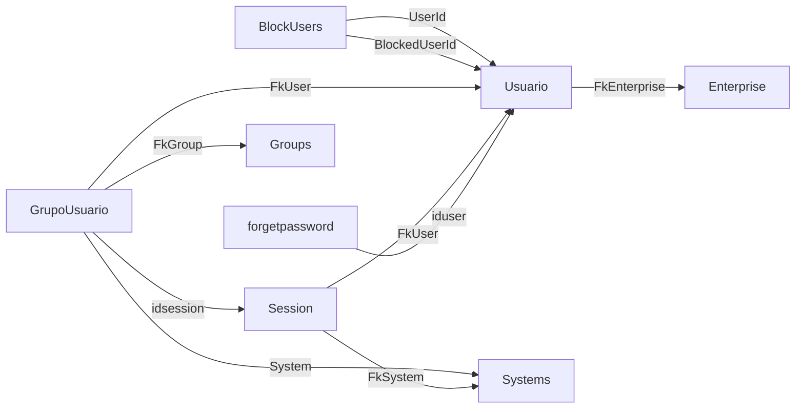

> Aviso de versionamento (extração via IA — Cursor): Este documento é um retrato da estrutura do banco SQL Server da WeCareU no momento da extração (2026-10-21). Descreve objetos, colunas ou campos, chaves, índices, volumes e relações. Não traz o conteúdo das linhas, não cruza com código e não descreve tela. Pode estar à frente ou atrás da base de conhecimento principal. Em caso de conflito com o repositório oficial ou com uma decisão da empresa, vale a fonte oficial.

# Banco `UserLogin`

Extração em 2026-10-21, host `server.wecareu.app`, collation `Latin1_General_CI_AS`, edição Developer Edition (64-bit), versão do produto 16.0.4305.5, nível RTM.

## Leitura da estrutura

Isto é leitura da estrutura, não decisão de produto. O nome `UserLogin` e as tabelas `Usuario`, `Session`, `forgetpassword`, `GrupoUsuario` e `BlockUsers` sugerem a identidade de quem acessa: o cadastro do usuário, a sessão autenticada, a recuperação de senha, o vínculo com grupo e o bloqueio entre usuários.

## Objetos que este banco não tem

Nenhuma view, procedure, function ou synonym. Nas cinco tabelas, nenhuma unique, nenhum índice além da chave primária, nenhuma chave estrangeira, nenhum check e nenhum trigger.

## Tabela `dbo.BlockUsers`

Linhas: 2. A contagem vem de `sys.partitions` (heap ou índice clustered), sem leitura das linhas.

Chave primária: `PK__BlockUse__3214EC07B599A437`, coluna `Id`.

Unique: Nenhuma.

Índices além da chave primária: Nenhum.

Chaves estrangeiras: Nenhuma.

Checks e triggers: Nenhum.

| Coluna | Tipo | Nulo | Identity | Default | Collation |
| --- | --- | --- | --- | --- | --- |
| `Id` | uniqueidentifier | não | não | `DF__BlockUsers__Id__5CD6CB2B` — expressão não visível para o login de leitura (sem VIEW DEFINITION) | — |
| `UserId` | uniqueidentifier | não | não | nenhum | — |
| `BlockedUserId` | uniqueidentifier | não | não | nenhum | — |
| `IsActive` | bit | não | não | `DF__BlockUser__IsAct__5DCAEF64` — expressão não visível para o login de leitura (sem VIEW DEFINITION) | — |
| `Created` | date | não | não | `DF__BlockUser__Creat__5EBF139D` — expressão não visível para o login de leitura (sem VIEW DEFINITION) | — |
| `DtChange` | date | não | não | `DF__BlockUser__DtCha__5FB337D6` — expressão não visível para o login de leitura (sem VIEW DEFINITION) | — |
| `ChangedBy` | varchar(50) | não | não | nenhum | Latin1_General_CI_AS |

## Tabela `dbo.GrupoUsuario`

Linhas: 1. A contagem vem de `sys.partitions` (heap ou índice clustered), sem leitura das linhas.

Chave primária: `PK__GrupoUsu__4DE8B112562AE065`, coluna `idsession`.

Unique: Nenhuma.

Índices além da chave primária: Nenhum.

Chaves estrangeiras: Nenhuma.

Checks e triggers: Nenhum.

| Coluna | Tipo | Nulo | Identity | Default | Collation |
| --- | --- | --- | --- | --- | --- |
| `idsession` | uniqueidentifier | não | não | `DF__GrupoUsua__idses__4222D4EF` — expressão não visível para o login de leitura (sem VIEW DEFINITION) | — |
| `FkGroup` | uniqueidentifier | não | não | nenhum | — |
| `FkUser` | uniqueidentifier | não | não | nenhum | — |
| `System` | uniqueidentifier | não | não | nenhum | — |
| `IsActive` | bit | não | não | `DF__GrupoUsua__IsAct__4316F928` — expressão não visível para o login de leitura (sem VIEW DEFINITION) | — |
| `Created` | date | não | não | `DF__GrupoUsua__Creat__440B1D61` — expressão não visível para o login de leitura (sem VIEW DEFINITION) | — |
| `DtChange` | date | não | não | `DF__GrupoUsua__DtCha__44FF419A` — expressão não visível para o login de leitura (sem VIEW DEFINITION) | — |
| `ChangedBy` | varchar(50) | não | não | nenhum | Latin1_General_CI_AS |

## Tabela `dbo.Session`

Linhas: 81. A contagem vem de `sys.partitions` (heap ou índice clustered), sem leitura das linhas.

Chave primária: `PK__Session__4DE8B112F2DA0975`, coluna `idsession`.

Unique: Nenhuma.

Índices além da chave primária: Nenhum.

Chaves estrangeiras: Nenhuma.

Checks e triggers: Nenhum.

| Coluna | Tipo | Nulo | Identity | Default | Collation |
| --- | --- | --- | --- | --- | --- |
| `idsession` | uniqueidentifier | não | não | `DF__Session__idsessi__3C69FB99` — expressão não visível para o login de leitura (sem VIEW DEFINITION) | — |
| `authtoken` | varchar(max) | não | não | nenhum | Latin1_General_CI_AS |
| `tokenvalid` | datetime | não | não | nenhum | — |
| `FkUser` | uniqueidentifier | não | não | nenhum | — |
| `IsActive` | bit | não | não | `DF__Session__IsActiv__3D5E1FD2` — expressão não visível para o login de leitura (sem VIEW DEFINITION) | — |
| `Created` | date | não | não | `DF__Session__Created__3E52440B` — expressão não visível para o login de leitura (sem VIEW DEFINITION) | — |
| `DtChange` | date | não | não | `DF__Session__DtChang__3F466844` — expressão não visível para o login de leitura (sem VIEW DEFINITION) | — |
| `ChangedBy` | varchar(50) | não | não | nenhum | Latin1_General_CI_AS |
| `refreshtoken` | varchar(max) | sim | não | nenhum | Latin1_General_CI_AS |
| `refreshtokenvalid` | datetime | sim | não | nenhum | — |
| `FkSystem` | uniqueidentifier | sim | não | nenhum | — |

## Tabela `dbo.Usuario`

Linhas: 6. A contagem vem de `sys.partitions` (heap ou índice clustered), sem leitura das linhas.

Chave primária: `PK__Usuario__3214EC07C120D437`, coluna `Id`.

Unique: Nenhuma.

Índices além da chave primária: Nenhum.

Chaves estrangeiras: Nenhuma.

Checks e triggers: Nenhum.

| Coluna | Tipo | Nulo | Identity | Default | Collation |
| --- | --- | --- | --- | --- | --- |
| `Id` | uniqueidentifier | não | não | `DF__Usuario__Id__36B12243` — expressão não visível para o login de leitura (sem VIEW DEFINITION) | — |
| `DsEmail` | varchar(256) | não | não | nenhum | Latin1_General_CI_AS |
| `DsSenha` | varchar(max) | não | não | nenhum | Latin1_General_CI_AS |
| `FkEnterprise` | uniqueidentifier | não | não | nenhum | — |
| `FkUserType` | uniqueidentifier | não | não | nenhum | — |
| `FkFoto` | uniqueidentifier | sim | não | nenhum | — |
| `FkSignature` | uniqueidentifier | sim | não | nenhum | — |
| `DsCPF` | varchar(11) | não | não | nenhum | Latin1_General_CI_AS |
| `DsRG` | varchar(27) | sim | não | nenhum | Latin1_General_CI_AS |
| `DsName` | varchar(max) | não | não | nenhum | Latin1_General_CI_AS |
| `IsActive` | bit | não | não | `DF__Usuario__IsActiv__37A5467C` — expressão não visível para o login de leitura (sem VIEW DEFINITION) | — |
| `Created` | date | não | não | `DF__Usuario__Created__38996AB5` — expressão não visível para o login de leitura (sem VIEW DEFINITION) | — |
| `DtChange` | date | não | não | `DF__Usuario__DtChang__398D8EEE` — expressão não visível para o login de leitura (sem VIEW DEFINITION) | — |
| `ChangedBy` | varchar(50) | não | não | nenhum | Latin1_General_CI_AS |
| `Gender` | char(1) | sim | não | nenhum | Latin1_General_CI_AS |
| `BirthDate` | date | sim | não | nenhum | — |
| `DsNickName` | varchar(200) | sim | não | nenhum | Latin1_General_CI_AS |
| `Stars` | decimal(10,5) | não | não | `DF__Usuario__Stars__01142BA1` — expressão não visível para o login de leitura (sem VIEW DEFINITION) | — |
| `TotalAvaliations` | int | não | não | `DF__Usuario__TotalAv__02084FDA` — expressão não visível para o login de leitura (sem VIEW DEFINITION) | — |

## Tabela `dbo.forgetpassword`

Linhas: 32. A contagem vem de `sys.partitions` (heap ou índice clustered), sem leitura das linhas.

Chave primária: `PK__forgetpa__57EBCE13B9A8411A`, coluna `idforgetpassword`.

Unique: Nenhuma.

Índices além da chave primária: Nenhum.

Chaves estrangeiras: Nenhuma.

Checks e triggers: Nenhum.

| Coluna | Tipo | Nulo | Identity | Default | Collation |
| --- | --- | --- | --- | --- | --- |
| `idforgetpassword` | uniqueidentifier | não | não | `DF__forgetpas__idfor__47DBAE45` — expressão não visível para o login de leitura (sem VIEW DEFINITION) | — |
| `iduser` | uniqueidentifier | não | não | nenhum | — |
| `token` | varchar(max) | não | não | nenhum | Latin1_General_CI_AS |
| `dtexpired` | date | não | não | nenhum | — |
| `IsActive` | bit | não | não | `DF__forgetpas__IsAct__48CFD27E` — expressão não visível para o login de leitura (sem VIEW DEFINITION) | — |
| `Created` | date | não | não | `DF__forgetpas__Creat__49C3F6B7` — expressão não visível para o login de leitura (sem VIEW DEFINITION) | — |
| `DtChange` | date | não | não | `DF__forgetpas__DtCha__4AB81AF0` — expressão não visível para o login de leitura (sem VIEW DEFINITION) | — |
| `ChangedBy` | varchar(50) | não | não | nenhum | Latin1_General_CI_AS |

## Relações declaradas

Nenhuma neste banco.

## Nomes que parecem ligação

- `UserLogin.dbo.BlockUsers.UserId` sugere destino `UserLogin.dbo.Usuario.Id`. Inferida pelo nome da coluna, não é constraint.
- `UserLogin.dbo.BlockUsers.BlockedUserId` sugere destino `UserLogin.dbo.Usuario.Id`. Inferida pelo nome da coluna, não é constraint.
- `UserLogin.dbo.GrupoUsuario.idsession` sugere destino `UserLogin.dbo.Session.idsession`. Inferida pelo nome da coluna, não é constraint.
- `UserLogin.dbo.GrupoUsuario.FkGroup` sugere destino `SystemsData.dbo.Groups.Id`. Inferida pelo nome da coluna, não é constraint.
- `UserLogin.dbo.GrupoUsuario.FkUser` sugere destino `UserLogin.dbo.Usuario.Id`. Inferida pelo nome da coluna, não é constraint.
- `UserLogin.dbo.GrupoUsuario.System` sugere destino `SystemsData.dbo.Systems.Id`. Inferida pelo nome da coluna, não é constraint.
- `UserLogin.dbo.Session.FkUser` sugere destino `UserLogin.dbo.Usuario.Id`. Inferida pelo nome da coluna, não é constraint.
- `UserLogin.dbo.Session.FkSystem` sugere destino `SystemsData.dbo.Systems.Id`. Inferida pelo nome da coluna, não é constraint.
- `UserLogin.dbo.Usuario.FkEnterprise` sugere destino `Enterprise.dbo.Enterprise.Id`. Inferida pelo nome da coluna, não é constraint.
- `UserLogin.dbo.forgetpassword.iduser` sugere destino `UserLogin.dbo.Usuario.Id`. Inferida pelo nome da coluna, não é constraint.

## Ligações

- [[banco-indice]]
- [[banco-sql-relacoes]]
